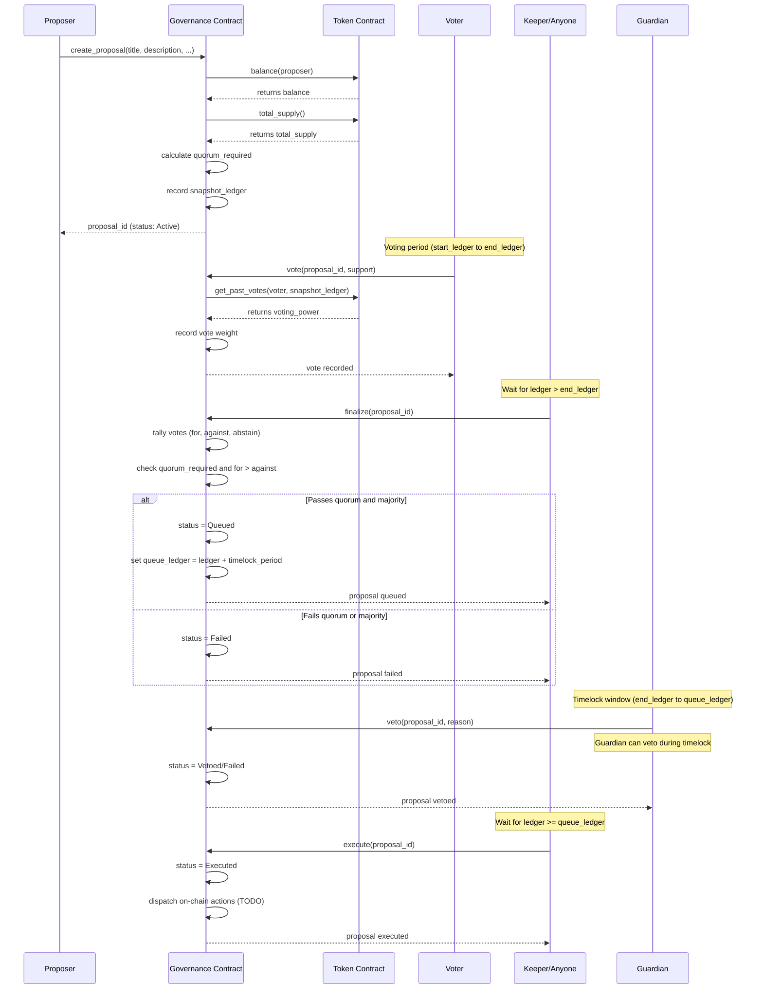
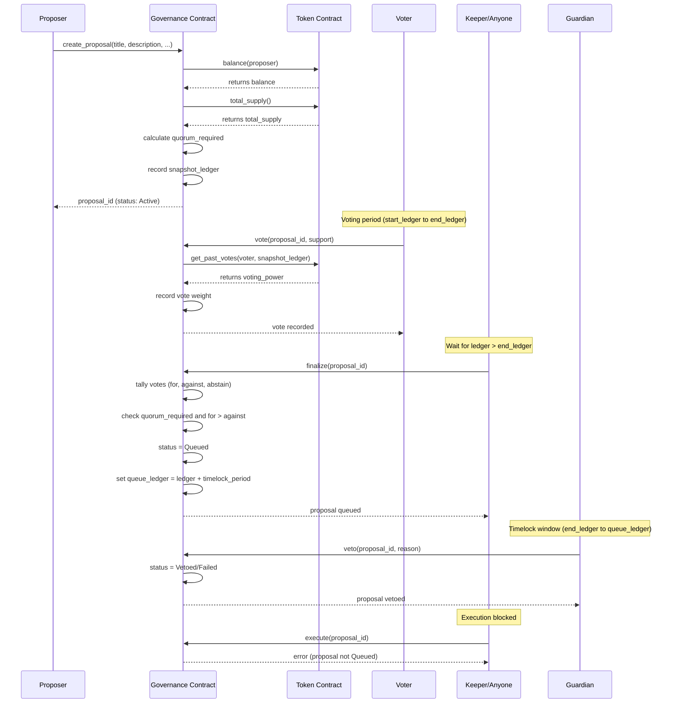

# Quorum Architecture

## Overview

Quorum is a monorepo containing four main packages:

1. **frontend/** — Next.js governance explorer and voting UI
2. **contracts/** — Soroban smart contracts: `governance` (`quorum-governance`)
   and the QUORUM `token` (`quorum-token`)
3. **sdk/** — TypeScript client SDK for dApp integration
4. **scripts/** — Deployment and operational tooling

This document describes the contracts as implemented in
`contracts/governance/src/lib.rs` and `contracts/token/src/lib.rs`. For
parameter tuning see [governance-parameters.md](governance-parameters.md); for
threats and mitigations see [security-model.md](security-model.md).

## Data Flow

```
Voter (Freighter Wallet)
        │  signs XDR transaction
        ▼
QuorumClient (sdk/)
        │  submits to Stellar RPC
        ▼
GovernanceContract ──── cross-contract calls ────► QuorumToken
  (proposals, votes,     total_supply()             (balances, checkpoints,
   quorum, timelock)     balance()                   allowances, supply)
        │                get_past_votes()
        ▼
   Contract events ──► Stellar ledger ──► indexers / clients
```

The governance contract holds the address of the token in `Config.token` and
calls it through a generated `TokenClient`. The token never calls governance.

## Contract Interaction Pattern

All state-changing operations follow this pattern:
1. Client builds an unsigned transaction (XDR) via `QuorumClient.build*()`
2. User signs with Freighter wallet
3. Client submits signed XDR to the Soroban RPC node
4. Contract validates authorization via `require_auth()`
5. State is updated and an event is emitted

## Cross-contract calls made by governance

Governance depends on three token functions (the `TokenInterface` trait in
`contracts/governance/src/lib.rs`):

| Governance function | Token call | Purpose |
|---|---|---|
| `create_proposal` | `balance(proposer)` | Live balance must be at least `Config.proposal_threshold`, otherwise `BelowProposalThreshold`. Deliberately live, since the threshold is about who may open a proposal now. |
| `create_proposal` | `total_supply()` | Derives `quorum_required = total_supply * quorum_bps / 10000` (checked multiply, integer division), frozen into the proposal at creation. Mints or burns during voting do not move the bar. |
| `vote` | `get_past_votes(voter, proposal.snapshot_ledger)` | The voter's weight. A result of 0 or less is rejected with `NoVotingPower`. |

`finalize`, `execute`, `cancel` and the view functions make no token calls.

## Proposal lifecycle

`create_proposal` records `snapshot_ledger` as the current ledger sequence,
`start_ledger = snapshot_ledger + 1` and
`end_ledger = start_ledger + voting_period`, and stores the proposal as
`Active`.

- **vote** — allowed while `ledger <= end_ledger` and the status is `Active`.
  `support` is `0` Against, `1` For or `2` Abstain; anything else is
  `InvalidVoteChoice`. One vote per address per proposal (`AlreadyVoted`).
- **finalize** — callable by anyone once `ledger > end_ledger`. The proposal
  moves to `Queued` (with `queue_ledger = ledger + timelock_period`) when total
  votes (for + against + abstain) reach `quorum_required` and `for_votes >
  against_votes`; otherwise it becomes `Failed`.
- **execute** — requires `Queued` and `ledger >= queue_ledger`
  (`TimelockNotExpired` before that). It marks the proposal `Executed`; the
  dispatch of on-chain actions is still a `TODO` in the contract.
- **cancel** — the proposer or the admin may cancel (`Unauthorized` for anyone
  else), and only while the proposal is `Active` and its voting window is open
  (`ProposalNotCancellable` otherwise).

`ProposalStatus` stores only the states the contract enters. `Pending` (before
voting opens) and `Passed` are reported by `get_proposal_phase`, not stored.

### Sequence Diagram: Happy Path



### Sequence Diagram: Vetoed Path



## Balance checkpoints and snapshot voting power

Voting power is the balance an address held at the proposal's
`snapshot_ledger`, not its live balance. Tokens acquired after a proposal opens
carry no weight, which blocks flash-loan and buy-the-vote attacks.

The token implements this with per-address checkpoints:

- `Checkpoint { ledger, balance }` entries are stored in a `Vec` under
  `DataKey::Checkpoints(owner)`, ordered by ledger.
- `set_balance()` is the single write path for balances. `initialize`,
  `transfer`, `transfer_from`, `mint` and `burn` all go through it, so every
  balance change writes a checkpoint.
- Several changes in one ledger collapse into one entry holding that ledger's
  closing balance, so each ledger appears at most once.
- `get_past_balance(owner, ledger)` binary-searches for the last checkpoint at
  or before `ledger` and returns its balance, or `0` if the address held nothing
  that far back.
- History is bounded by `CHECKPOINT_RETENTION` (60 days of ledgers, twice the
  longest voting period the create form offers). On every write, entries older
  than the window are pruned, except the newest of them, which is kept as the
  balance in effect at the cutoff. A snapshot older than the window therefore
  reads as `0`; raise the constant if governance is ever configured with a longer
  `voting_period`. See [contracts/token/README.md](../contracts/token/README.md#checkpoint-growth).

Delegation is recorded in the token under `Delegate` and `VoteCheckpoints`.
Every balance change updates the effective representative's weight, and
delegation changes move only the holder's own weight between representatives.
`get_past_votes(account, ledger)` reads these checkpoints with the same ledger
boundary, pruning, and TTL rules as balance history. Existing balance history is
preserved as self-voting history when first materializing vote checkpoints.

Governance exposes `delegate`, `undelegate`, and `get_delegate`, forwarding to the
configured token. Its local mapping records facade calls; views and voting use
the token so direct token calls cannot create stale voting-power calculations.
`vote()` reads `get_past_votes` at the proposal snapshot and rejects calls before
`start_ledger`, ensuring the snapshot ledger has closed before votes are counted.

## Allowances and expiry (token)

`approve(owner, spender, amount, expiration_ledger)` stores an
`AllowanceValue { amount, expiration_ledger }` under
`DataKey::Allowance(owner, spender)`, as SEP-41 requires.

- A live approval (`amount > 0`) whose `expiration_ledger` is before the current
  ledger is rejected with `InvalidExpiration`. `amount == 0` revokes and accepts
  any expiration. A negative amount is `InvalidAmount`.
- An allowance is usable through `expiration_ledger` inclusive. Afterwards
  `allowance()` returns `0` and `transfer_from` fails with
  `InsufficientAllowance`; an expired allowance never errors on read.
- `transfer_from(spender, from, to, amount)` requires the spender's auth, moves
  the balance first (so a failed spend cannot consume allowance), then debits
  the allowance while keeping its original expiry.

## Co-sponsored proposals

Design note for `create_cosponsored_proposal`, for the case where no single
holder meets `proposal_threshold` but a group together does.

**Authorization.** All co-sponsors sign the same transaction as the proposer,
and each one's `require_auth()` is checked there. The alternative was a pledge
registry, where co-sponsors sign an off-chain intent and a submitter reads the
pledges at creation. A registry needs a write per pledge, expiry handling and a
way to revoke pledges, and the threshold check needs none of that. The cost of
the chosen model is that every co-sponsor must be online to sign at once.

**Threshold.** The sum of the live balances of the proposer and every
co-sponsor must reach `proposal_threshold`. The check is the same as for a single
proposer, and a shortfall fails with `BelowProposalThreshold`. Co-sponsorship
adds no votes: each voter's weight is still their snapshot balance when they vote.

**Limits.** At most `MAX_COSPONSORS` (10) co-sponsors. No duplicates, and the
proposer may not be listed (`InvalidCosponsors`). The list is stored under
`CoSponsors(id)`. The proposer alone pays any proposal deposit.

## Conviction voting

A conviction proposal (`create_conviction_proposal`) keeps a time-decayed tally
of support next to the usual raw totals.

- A For or Against vote of weight `w` is added to its side at ledger `t`. Each
  side is first brought forward to `t`.
- Bringing a side forward by `d` ledgers halves it `floor(d / H)` times, where
  `H = CONVICTION_HALF_LIFE` (3 days, 51,840 ledgers). Decay is stepwise, and a
  shift of 128 or more leaves zero.
- At `finalize`, both sides are brought forward to `end_ledger`. The proposal
  passes when For is strictly greater than Against and quorum is met.

Because decay is applied at the close and not at `finalize`, the result is the
same whenever `finalize` is called. The window and quorum are the same as for
standard proposals.

## Event model

Both contracts publish a typed event for every state change. Each event has a
topic tuple (a symbol first, then identifiers) and a struct payload.

### Governance

| Topics | Payload | Emitted by |
|---|---|---|
| `("proposal_created", id)` | `ProposalCreated { id, proposer, title, start_ledger, end_ledger, quorum_required }` | `create_proposal` |
| `("vote_cast", proposal_id, voter)` | `VoteCast { proposal_id, voter, support, voting_power }` | `vote` (power is the snapshot weight actually counted) |
| `("proposal_finalized", id)` | `ProposalFinalized { id, status, for_votes, against_votes, abstain_votes }` | `finalize` |
| `("proposal_queued", id)` | `ProposalQueued { id, queue_ledger }` | `finalize`, only when the proposal passes, after `proposal_finalized` |
| `("proposal_executed", id)` | `ProposalExecuted { id }` | `execute` |
| `("proposal_cancelled", id)` | `ProposalCancelled { id, caller }` | `cancel` |
| `("proposal_deposit_updated")` | `ProposalDepositUpdated { amount }` | `set_proposal_deposit` |
| `("deposit_refunded", id)` | `DepositRefunded { id, proposer, amount }` | `finalize`, when the proposal passes |
| `("deposit_forfeited", id)` | `DepositForfeited { id, amount }` | `finalize`, when the proposal fails; `cancel` |
| `("target_allowlist_updated", target)` | `TargetAllowlistUpdated { admin, target, allowed }` | `allow_target`, `disallow_target` |
| `("proposal_action_set", id)` | `ProposalActionSet { id, target, function }` | `set_proposal_action` |

Co-sponsors are not in `ProposalCreated`; read them with `get_cosponsors`.

### Token

| Topics | Payload | Emitted by |
|---|---|---|
| `("mint", to)` | `Mint { to, amount, total_supply }` | `mint`, and `initialize` for the genesis allocation |
| `("burn", from)` | `Burn { from, amount, total_supply }` | `burn` |
| `("transfer", from, to)` | `Transfer { from, to, amount }` | `transfer` and `transfer_from` (same event for both) |
| `("approve", owner, spender)` | `Approve { owner, spender, amount, expiration_ledger }` | `approve` |
| `("admin_transferred", previous_admin)` | `AdminTransferred { previous_admin, new_admin }` | `transfer_admin` |

`total_supply` in `Mint` and `Burn` is the value after the operation, so supply
can be reconstructed from events alone.

## Storage layout and TTL management

Soroban entries expire unless their TTL is extended.

### Governance

| Storage | Keys | Contents |
|---|---|---|
| Instance | `Config`, `ProposalCount` | Token address, `quorum_bps`, `voting_period`, `timelock_period`, `proposal_threshold`, admin; proposal counter |
| Persistent | `Proposal(id)` | The `Proposal` struct |
| Persistent | `HasVoted(id, voter)` | The voter's recorded `support` value |

Constants: `TTL_THRESHOLD` is 30 days and `TTL_EXTEND_TO` is 90 days, at 17,280
ledgers per day (about 5 seconds per ledger). When an entry's remaining life
falls below 30 days, it is extended back to 90 days. The 30-day threshold is
deliberately above the longest voting period the create form offers, so a
proposal cannot expire mid-vote.

Extensions happen on `create_proposal` (proposal and instance), `vote`
(proposal, that vote and instance), `finalize`, `execute` and `cancel`
(proposal), and on `get_proposal`, so a watched proposal stays alive even with
no voting activity.

### Token

| Storage | Keys | Contents |
|---|---|---|
| Instance | `Admin`, `Name`, `Symbol`, `Decimals`, `TotalSupply` | Token metadata, admin and supply |
| Persistent | `Balance(owner)` | Live balance |
| Persistent | `Allowance(owner, spender)` | `AllowanceValue` |
| Persistent | `Checkpoints(owner)` | `Vec<Checkpoint>` |

The token uses the same constants as governance (`TTL_THRESHOLD` 30 days,
`TTL_EXTEND_TO` 90 days). This matters more for the token than it looks:
snapshot voting power is read from `Checkpoints`, so an expired entry would make
`get_past_balance` return `0` and silently strip a holder's vote.

`Balance`, `Checkpoints` and `Allowance` entries are extended whenever they are
written, and on reads that find them (`balance`, `get_past_balance`, `allowance`
and the internal paths that use them). Expired allowances are not extended.
Instance storage is extended on every balance write and on `total_supply` and
`get_past_balance`.

## Errors

Both contracts return typed errors (`#[contracterror]`) rather than panicking.
`GovernanceError` codes 1-27 and `TokenError` codes 1-7 are defined in the
respective `lib.rs`. `mint` returns `TokenError::Overflow` instead of trapping
when it would overflow total supply, and `burn` returns it rather than taking
total supply below zero.
