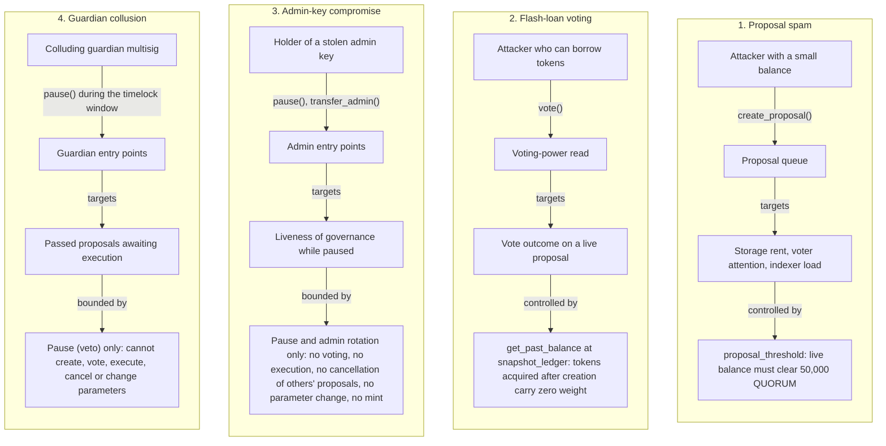

# Security Model & Threat Assumptions

## Overview

Quorum is a token-weighted governance system on Stellar. This document describes the threats it is designed to resist, the trust assumptions it makes, and the known gaps.

## Threat Model

### Threat model at a glance

The diagram maps each headline vector to the attacker behind it, the contract
entry point they would use, the asset or outcome they target, and the control
that stops them. It is a review aid for the prose sections that follow — where
the diagram and the prose disagree, the prose (checked against the code) wins
and the diagram is a bug. See [Audit Scope](audit-scope.md) for how these
vectors are covered by third-party review.



### Revisiting the threat model

Any PR that expands the attack surface — a staking module, `execute()` action
dispatch, multi-wallet support, vote delegation, a new admin or guardian
capability — must update this diagram and the prose above in the same PR.
Checklist for the author and the reviewer:

- [ ] Every new externally callable function appears as an entry point, or the PR states why it is not attacker-reachable
- [ ] Any new asset (custodied tokens, delegated power, accrued rewards) is named as a target
- [ ] Each new vector has a stated control; a vector with no control is recorded under Known Gaps, not omitted
- [ ] The Trust Assumptions table still matches the roles and powers the code actually grants
- [ ] The diagram renders on GitHub and the function names in it match the contract interface

### 1. Flash-Loan Vote Manipulation
**Threat:** An attacker borrows a large amount of QUORUM tokens, votes, and returns them in a single transaction.
**Mitigation:** Voting power is read at the proposal's **snapshot ledger** (the ledger when the proposal was created), not the current balance. Tokens acquired after the snapshot carry zero voting power. The snapshot is immutable once set.

### 2. Governance Attack via Low Quorum
**Threat:** An attacker with a small token fraction passes a proposal when few others vote.
**Mitigation:** The `quorum_bps` parameter sets a minimum total voting power (For + Against + Abstain) that must participate. Without reaching quorum, a proposal fails regardless of the vote distribution.

### 3. Rush Execution
**Threat:** A passed proposal is executed immediately before token holders can react.
**Mitigation:** All passed proposals enter a **timelock** (default ~48 hours) before execution. During this window, the guardian multisig can veto.

### 4. Spam Proposals
**Threat:** An attacker fills the proposal queue with low-quality proposals.
**Mitigation:** The `proposal_threshold` requires proposers to hold a minimum token balance (default 50,000 QUORUM). This makes spamming costly.

### 5. Admin Key Compromise
**Threat:** The admin key is stolen or misused.
**Mitigation:** The admin cannot cancel proposals, so a stolen key cannot silence a proposal or burn a proposer's deposit. It can pause the contract and rotate the admin; it cannot vote on behalf of others, execute without timelock, or change governance parameters. The admin key should still be held in a multisig or hardware wallet.

### 6. Guardian Abuse
**Threat:** The guardian multisig vetoes a legitimate proposal.
**Mitigation:** The guardian is a trusted role (typically a security multisig). This is a deliberate trade-off: the guardian provides a safety net against governance attacks at the cost of centralized veto power. The guardian cannot execute or modify proposals — only veto during the timelock window.

### Why the admin cannot cancel proposals (#425)

The guardian veto and pause already cover the emergency cases. Guardian veto
stops a passed proposal during its timelock; pause halts creation, voting and
execution while a situation is assessed. Admin cancellation duplicated those
controls while adding a censorship lever: one key could stop any live proposal
and burn the proposer's deposit, even though the proposer is the only party
that chose to open it. The role was therefore removed rather than narrowed.
Cancellation is now proposer-only, and the proposer's deposit follows the
#430 rule (refunded before voting starts, forfeited once it has). If an admin
key is abused, there is no proposal-cancellation power to abuse; the remaining
actions are bounded in [Threat 5](#5-admin-key-compromise).

### 7. Storage-Rent Exhaustion / State-Bloat Griefing
**Threat:** An attacker floods the contract with minimum-threshold proposals (each creating persistent entries: the proposal itself, a proposer index entry, and a proposer counter) so that persistent storage grows faster than TTL-extension costs discourage it.
**Mitigation:** Every entry the contract writes is persistent storage rented from the network at protocol rates, paid by whoever creates or extends it; new persistent entries are born with the network's ~120-day minimum lifetime and are archived again unless someone keeps paying. The full quantified analysis — current mainnet fee parameters, per-proposal and 10k-proposal attack costs, cost attribution, and the conclusion — is in [Storage-Rent Exhaustion Analysis](#storage-rent-exhaustion-analysis) below.

### 8. Transaction Front-Running / MEV on `vote()` and `finalize()**
**Threat:** `vote()` and `finalize()` are public, content-unauthenticated calls whose outcomes are visible before confirmation; an attacker with mempool visibility could front-run a close vote or a finalize.
**Mitigation:** Voting power is fixed at the proposal's snapshot ledger and tallies are commutative additions, so transaction ordering cannot change any weight or outcome; Stellar has no public ordered mempool or fee-priority market to arbitrage in any case. The full analysis — including the residual vectors and the one future change that would create real MEV surface — is in [Front-Running and MEV Analysis](#front-running-and-mev-analysis) below.

---

## Trust Assumptions

| Actor | Power | Assumption |
|-------|-------|------------|
| **Admin** | Pause the contract; rotate the admin and guardian | Holds the admin key; acts in good faith or is a multisig |
| **Guardian** | Veto queued proposals during timelock | Trusted security multisig; acts as last-resort safety |
| **Token holders** | Vote, propose (if above threshold) | Rational economic actors; hold tokens for governance |
| **Stellar network** | Ledger ordering, snapshot integrity | Stellar consensus is operating correctly |

### What the Admin CAN do
- Pause and unpause the contract
- Rotate the admin and guardian, and set the proposal deposit, proposer cooldown and action allowlist
- Deploy the initial contracts

### What the Admin CANNOT do
- Cancel a proposal opened by someone else (cancellation is proposer-only)
- Vote on behalf of others
- Execute proposals without timelock
- Change governance parameters (no `update_config()` exists)
- Mint or burn tokens (token admin is separate)

### What the Guardian CAN do
- Veto a queued proposal during the timelock window

### What the Guardian CANNOT do
- Create or vote on proposals
- Execute proposals
- Cancel proposals (cancellation is proposer-only)

---

## Known Gaps

1. **No parameter upgrade path.** Once initialized, governance parameters (`quorum_bps`, `voting_period`, etc.) are permanent. There is no `update_config()`. A new contract instance must be deployed to change parameters, requiring token migration.

2. **No vote delegation.** Delegation is planned but not yet implemented. Currently, voting power is strictly non-transferable balance at the snapshot.

3. **No on-chain action execution.** The `execute` function marks the proposal as executed but does not dispatch arbitrary on-chain actions. This is a TODO in the contract.

4. **Single admin key.** The admin is a single address, not a multisig by default. Deployers should use a multisig or hardware wallet for the admin key. See [Admin Key Management Guide](admin-key-management.md) for custody best practices.

5. **No vote change or withdrawal.** Once a vote is cast, it cannot be changed or withdrawn.

6. **Quorum is calculated at finalize time.** The quorum requirement is fixed at proposal creation based on total supply, but actual participation is checked at finalize. If total supply changes significantly between creation and finalize (e.g. large mint/burn), the quorum target may be stale.

---

## Deep-Dive Analyses

### Storage-Rent Exhaustion Analysis

*Companion to Threat Model #7. Reviews whether a flood of minimum-threshold
proposals — each one writing a `Proposal` entry, a `ProposerIndex` entry, and
a `ProposerCount` entry to persistent storage (`create_proposal` in
`contracts/governance/src/lib.rs`), all TTL-extended by
`touch_proposal`/`touch_instance` — can grow state faster than the network's
rent pricing discourages.*

#### Network fee model (what a proposal actually costs)

Soroban rents persistent storage as:

```
rent = bytes × ledgers × fee_per_rent_1kb / (1024 × persistentRentRateDenominator)
```

with the parameters below (mainnet, Protocol 21 config as served by Stellar
Lab, values read October 2026):

| Parameter | Value | Effect |
| --- | --- | --- |
| `MINIMUM_RENT_WRITE_FEE_PER_1KB` | 1,000 stroops | Floor on the rent rate. Live Soroban state is ≈ 0.99 GB of the 3 GB `sorobanStateTargetSizeBytes`, so the state-size curve computes a rate *below* the floor today and the floor applies. |
| `persistentRentRateDenominator` | 1,215 | 1 KiB is charged 1,000 stroops every 1,215 ledgers ≈ 0.82 stroops/KiB/ledger |
| `min_persistent_ttl` | 2,073,600 ledgers (~120 days) | Every newly created persistent entry is born with ~120 days of paid-for life — a new entry cannot be created shorter. |
| `fee_write_ledger_entry` | 2,500 stroops | One-off per entry written |
| Inclusion + instruction + historical fees | ~0.001–0.005 XLM per tx | Small relative to rent |

Derived rent rates at the floor:

| Lifetime | Ledgers | Rent per KiB |
| --- | --- | --- |
| 30 days (`TTL_THRESHOLD`) | 518,400 | ≈ 0.043 XLM |
| 90 days (`TTL_EXTEND_TO`) | 1,555,200 | ≈ 0.128 XLM |
| 120 days (birth TTL, the floor that matters) | 2,073,600 | ≈ 0.171 XLM |

A nuance worth recording: `touch_proposal`/`touch_vote` only extend when
remaining life drops below the 30-day threshold, and a brand-new persistent
entry already has ~120 days — so `create_proposal`'s touch calls are no-ops
on creation. The 90-day extension cost is paid on later writes (votes,
finalize, cancel) or when an entry first falls under 30 days.

#### Per-proposal cost and attack budgets

Entries per proposal: `Proposal(id)` ≈ 0.55 KiB with a short title/description
(≈ 10.5 KiB at `MAX_DESCRIPTION_LENGTH`), `ProposerIndex` ≈ 0.12 KiB,
`ProposerCount` ≈ 0.10 KiB — ≈ 0.77 KiB total for a minimal proposal.

| Scenario | Proposals | Persistent state | Cost (rent + write fees) |
| --- | --- | --- | --- |
| Trivial spam (short text) | 100 | ≈ 77 KiB | ≈ 15 XLM |
| Trivial spam | 1,000 | ≈ 0.75 MiB | ≈ 150 XLM |
| Trivial spam | 10,000 | ≈ 7.5 MiB | ≈ 1,500 XLM (~US$450 at an illustrative $0.30/XLM) |
| Max-description spam | 10,000 | ≈ 103 MiB | ≈ 18,000 XLM |

10,000 minimal proposals buy an attacker ≈ 7.5 MiB — about 0.25% of the
network's 3 GB Soroban state target — and every byte of it is archived again
after ~120 days unless the attacker *keeps paying* the same rates to extend
it. The bloat is rent-controlled decay, not permanent pollution.

#### Amplifiers checked

- **Throughput:** `ledger_max_write_entries` is 1,000 network-wide and
  `tx_max_write_ledger_entries` is 200; each proposal writes ≈ 4 entries
  (3 contract + 1 TTL). Spam rate is bounded by ledger write capacity, not
  by any contract logic — there is no per-address rate limit and no
  cool-down (tracked as a companion anti-spam issue), so one address holding
  `proposal_threshold` can produce every proposal. The threshold is a
  balance check, not a bond: the 50,000 QUORUM (default) stays in the
  attacker's wallet.
- **Cost attribution:** the attacker pays 100% of creation rent and of any
  extension they trigger. `get_proposal`/`get_proposals` also call
  `touch_proposal` — but the frontend and SDK read through Soroban RPC
  *simulation*, which never persists state and never pays rent, so the
  normal read path cannot be tricked into renewing the attacker's entries.
  Only a client that deliberately submits refresh transactions would, and it
  would pay for them itself.
- **Fee-market feedback:** while network state stays under the 3 GB target,
  rent is pinned at the floor and spam does not raise other users' fees.
  Past the target the rate grows linearly (×5,000 factor beyond it), so
  storage gets *more* expensive exactly when it is scarce — the pricing
  curve scales against the attack rather than with it.
- **Pagination blast radius:** `get_proposals`/`get_proposals_by_proposer`
  are bounded (`MAX_PAGE_SIZE = 100`), so listing reads do not become
  unbounded even with 10k spam proposals on chain.

#### Conclusion

**The existing fee cost is a sufficient deterrent** against storage-rent
exhaustion / state-bloat griefing at current network parameters: the attack
buys little state at the network's floor rent, decays unless continuously
re-funded by the attacker, cannot shift meaningful cost onto honest users,
and becomes automatically more expensive if network storage tightens. This
conclusion is conditional on the companion anti-spam work (proposer
cool-down and/or bonded deposit, which price the *spam UX* rather than
storage) and should be revisited if `min_persistent_ttl`, the rent floor,
or `MAX_DESCRIPTION_LENGTH` change materially.

### Front-Running and MEV Analysis

*Companion to Threat Model #8. Reviews whether public, content-unauthenticated
`vote()` and `finalize()` calls create a front-running or MEV opportunity on
Soroban's execution model.*

#### Execution model facts

1. **No public ordered mempool.** Stellar orders transactions through SCP
   among known validators; there is no broadcast mempool whose ordering is
   visible and arbitrable before confirmation, and no fee-priority market.
   "Visible before confirmation" on Stellar does not translate into the
   positioning instrument that MEV strategies need.
2. **Voting power is snapshot-fixed.** `vote()` reads weight via
   `get_past_balance(voter, snapshot_ledger)` — fixed at proposal creation.
   Reordering transactions cannot mint, dilute, or defer anyone's weight,
   and tallies are commutative additions into `for/against/abstain`. Any
   permutation of the same set of valid votes produces the same final
   tallies.
3. **`finalize()` is deterministic.** It is a pure function of stored
   tallies and `end_ledger`; whoever submits it first computes the same
   `Queued`/`Failed` status. A front-run finalize changes nothing.
4. **The only ordering-sensitive bit is validity, not value.** A vote
   submitted before `end_ledger` but applied after it fails
   (`VotingPeriodEnded`). That is a liveness race against the clock — the
   same for everyone — not an extractable ordering premium.

#### Information "front-running"

Observing a close tally in transaction metadata before casting your own vote
reveals nothing that `get_proposal` (or an RPC simulation) has not been
showing everyone for the entire voting window. Acting on it — voting with
your already-fixed snapshot weight, or staying home — is ordinary voting,
not arbitrage.

#### Residual vectors (documented, not mitigations)

- **Validator-level last-ledger censorship** of votes could deny a
  last-moment swing vote inclusion. This requires sustained consensus-level
  misbehavior by validators, is observable on-chain, and is a property of
  Stellar itself rather than of this contract.
- **Proposer `cancel()`, admin `pause()` and guardian veto** are the only
  discretionary outcomes. They are off-chain multisig decisions with public
  on-chain effects; there is no mempool to arbitrage them in.
- **Indexer/event-ordering games** are cosmetic: events are published after
  state is committed, and consumers should treat tallies from storage as
  authoritative.

#### Future risk

When `execute()` gains on-chain action dispatch (current TODO), execution
becomes genuinely MEV-bearing: withholding or sandwiching a protocol action
would have value. This analysis should be re-run at that point; nothing
about `vote()`/`finalize()` carries over automatically.

#### Conclusion

**No meaningful front-running or MEV risk exists on `vote()` and
`finalize()`** under Soroban's execution model, because voting power is
fixed at a snapshot, tallies are order-independent, finalize is
deterministic, and Stellar exposes no ordered public mempool to arbitrage.
No contract change is recommended; the analysis is marked for re-evaluation
when proposal action dispatch is implemented.

---

## Recommendations for Production Deployment

1. Use a **multisig** for the admin key (e.g. 3-of-5). See [Admin Key Management Guide](admin-key-management.md) for detailed custody and rotation procedures.
2. Use a dedicated **security multisig** for the guardian role. See [Incident Response Runbook](incident-response.md) for when and how to use veto power.
3. Deploy on **testnet first** and run through a full governance cycle before mainnet.
4. Monitor the `proposal_created`, `vote_cast`, and `proposal_finalized` events for anomalies.
5. Consider starting with a **higher quorum** (e.g. 10%) and lowering it as participation grows.
6. Establish a **delegate program** to increase participation. See [Delegate Program Guide](delegate-program.md) for best practices.
